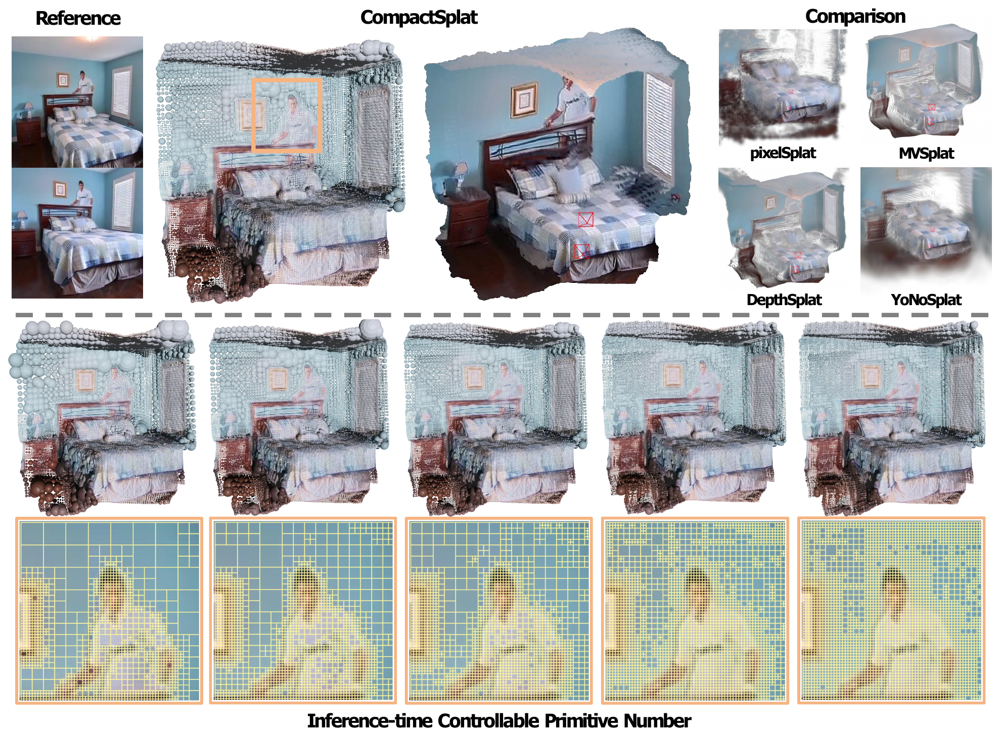
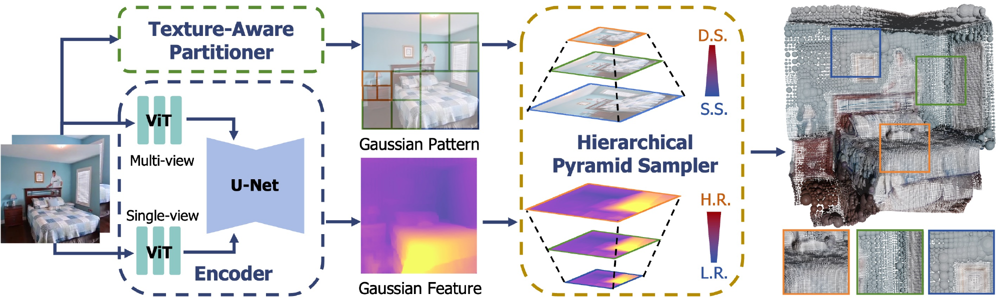

<h1 align="center">CompactSplat: Spatially Adaptive Gaussian Distribution for Feedforward Scene Reconstruction</h1>

<p align="center">
  Bing He · Jingnan Gao · Yunuo Chen · Zhengxue Cheng · Rong Xie · Li Song · Wenjun Zhang
</p>
<h3 align="center">NeurIPS 2026 (Poster)</h3>
<p align="center">
  <a href="https://openreview.net/forum?id=3sn6PeO6Ch">Paper &amp; OpenReview</a> ·
  <a href="website/README.md">Project Website Source</a> ·
  <a href="MODEL_ZOO.md">Model Status</a> ·
  <a href="docs/REPRODUCIBILITY.md">Reproducibility Notes</a>
</p>

<p align="center">
  
</p>
<p align="center"><strong>Allocate Gaussians where image content needs them.</strong><br>
CompactSplat reconstructs a scene from two posed input images and lets one model trade representation size for rendering quality at inference time.</p>

> **Implementation status.** CompactSplat checkpoints have not been released. The current partition criterion and default thresholds differ from the paper; see the [reproducibility notes](docs/REPRODUCIBILITY.md) before interpreting results.

## Methodology

CompactSplat builds on the feedforward reconstruction backbone and surface priors of [SurfSplat](https://github.com/hebing-sjtu/SurfSplat) and [DepthSplat](https://github.com/cvg/depthsplat). Its contribution is content-adaptive Gaussian allocation:

- **Texture-Aware Partitioner (TAP):** recursively subdivides image regions according to local appearance variation, retaining larger blocks in homogeneous regions and smaller blocks around detail.
- **Hierarchical Pyramid Sampler (HPS):** queries Gaussian attributes from a scale pyramid at each block's center and adjusts primitive extent using the block footprint.
- **Inference-time sparsity control:** adjusts the partition threshold without retraining the network. The paper uses dense initialization followed by training with varying thresholds.

<p align="center">
  
</p>

Camera intrinsics and poses are required. Allocation is performed within each input view; cross-view duplicate removal is not part of this method. High-Resolution Rendering Consistency (HRRC) follows SurfSplat and evaluates the same reconstructed Gaussians at ×1, ×2, and ×4 render resolutions. It measures rendering behavior and does not establish watertight geometry.

### Results reported in the paper

RealEstate10K, two 256 × 256 input views, standard-resolution novel-view evaluation:

| Variant | PSNR ↑ | SSIM ↑ | LPIPS ↓ | Gaussians per input pixel ↓ | Gaussians ↓ |
| :--- | ---: | ---: | ---: | ---: | ---: |
| CompactSplat-S | 27.086 | 0.884 | 0.123 | 0.554 | 72.6k |
| CompactSplat-B | 27.523 | 0.891 | 0.118 | 0.554 | 72.6k |
| CompactSplat-L | 27.567 | 0.892 | 0.117 | 0.554 | 72.6k |

These are paper-reported values, not a new benchmark of this checkout. At 0.554 Gaussians per input pixel, the representation uses approximately 44.6% fewer primitives than a one-Gaussian-per-pixel allocation. See the [paper](https://openreview.net/forum?id=3sn6PeO6Ch) for full comparisons and HRRC results.

## Roadmap

- [x] Include TAP, HPS, training, and evaluation source code.
- [x] Document paper settings and current implementation differences.
- [x] Include the static project website source.
- [ ] Validate a paper-matched configuration and checkpoint end to end.
- [ ] Release CompactSplat checkpoints with configuration files and checksums.
- [ ] Complete the isolated HPS finest-level versus multilevel ablation.

## Repository

```bash
git clone git@github.com:hebing-sjtu/CompactSplat.git
cd CompactSplat
```

Access currently requires permission to the private repository. Inherited configuration and script names such as `depthsplat` are retained for compatibility.

| Location | Purpose |
| :--- | :--- |
| [src/dataset/GS_pattern](src/dataset/GS_pattern) | Adaptive image partitioning and Cython quadtree implementation |
| [gaussian_adapter.py](src/model/encoder/common/gaussian_adapter.py) | Hierarchical attribute sampling and Gaussian construction |
| [config](config) | Hydra dataset, model, and experiment configurations |
| [scripts](scripts) | Training, evaluation, setup, and runtime checks |
| [website](website) | Project website source and paper figures |
| [slurm_re10k_train.sbatch](scripts/slurm_re10k_train.sbatch) | Example multi-node SLURM launcher |

## Installation

The original dependency set targets **Python 3.10, PyTorch 2.4.0, and CUDA 12.4**. Run on a Linux machine with an NVIDIA GPU, a matching CUDA toolkit, and a C++ compiler:

```bash
conda create -y -n compactsplat python=3.10
conda activate compactsplat
python -m pip install torch==2.4.0 torchvision==0.19.0 --index-url https://download.pytorch.org/whl/cu124
python -m pip install -r requirements.txt
python -m pip install Cython setuptools
(cd src/dataset/GS_pattern && python setup.py build_ext --inplace)
python -m scripts.check_rasterizer
```

Run these commands from the repository root. The requirements install the [modified rasterizer](https://github.com/dcharatan/diff-gaussian-rasterization-modified) used by this code. Rebuild the Cython extension after changing its source.

For an H200 container environment, use `bash scripts/setup_h200.sh /path/to/venv`. That setup preserves the container's PyTorch and checks it against [constraints-image.txt](constraints-image.txt); it is a separate environment from the original dependency set.

## Model Zoo

**CompactSplat trained weights are pending release.** [MODEL_ZOO.md](MODEL_ZOO.md) distinguishes the required initialization weights from inherited DepthSplat baseline checkpoints. Upstream checkpoints are not substitutes for a trained CompactSplat checkpoint.

For the small backbone used in the smoke test below:

```bash
bash scripts/download_pretrained.sh vits
```

Use `vitb` or `vitl` for the corresponding backbone and match the checkpoint architecture to the model configuration.

## Datasets

See [DATASETS.md](DATASETS.md) for RealEstate10K, ACID, DL3DV, DTU, and ScanNet preparation, dataset roots, and evaluation indices. Training expects prepared `.torch` chunks and `index.json` files; the small upstream demonstration subsets are insufficient for training.

## Training

The following **20-step smoke test** exercises the current small-model configuration. Replace the dataset root with a prepared RealEstate10K dataset:

```bash
CUDA_VISIBLE_DEVICES=0 python -m src.main +experiment=re10k \
  dataset.roots=[/path/to/re10k] \
  trainer.max_steps=20 \
  trainer.num_sanity_val_steps=0 \
  data_loader.train.batch_size=2 \
  data_loader.train.num_workers=2 \
  train.eval_model_every_n_val=0 \
  checkpointing.pretrained_monodepth=pretrained/depth_anything_v2_vits.pth \
  checkpointing.pretrained_mvdepth=pretrained/gmflow-scale1-things-e9887eda.pth \
  wandb.mode=disabled \
  output_dir=outputs/compactsplat-smoke
```

This uses current development defaults, not the paper's full training schedule. The two-stage paper protocol, threshold overrides, and unresolved reproduction requirements are documented in [docs/REPRODUCIBILITY.md](docs/REPRODUCIBILITY.md). The legacy [training script](scripts/re10k_depthsplat_train.sh) contains example SurfSplat checkpoint paths and launches an ACID experiment in its active command; adapt it before use. Those checkpoint files are not included.

The [SLURM launcher](scripts/slurm_re10k_train.sbatch) requests two nodes with eight GPUs each. It requires `REPO`, `VENV`, and `DATA_ROOT` to resolve identically on both nodes:

```bash
export REPO=/path/to/CompactSplat
export VENV=/path/to/venv
export DATA_ROOT=/path/to/re10k
cd "$REPO"
mkdir -p slurm-logs
sbatch --partition=YOUR_PARTITION scripts/slurm_re10k_train.sbatch
```

Replace `YOUR_PARTITION` with your cluster's partition. The launcher defaults to `VIT=vitl`, so download matching initialization weights first. `OUTPUT_DIR` defaults to `$REPO/outputs/re10k` and may be overridden with a shared path. Set your own `wandb.entity` if enabling W&B logging.

## Evaluation

A trained CompactSplat checkpoint is required. This example evaluates a **large-model** checkpoint on RealEstate10K with two views and a fixed partition threshold:

```bash
CUDA_VISIBLE_DEVICES=0 python -m src.main +experiment=re10k \
  mode=test \
  dataset.roots=[/path/to/re10k] \
  dataset/view_sampler=evaluation \
  dataset.view_sampler.num_context_views=2 \
  dataset.view_sampler.index_path=assets/evaluation_index_re10k.json \
  dataset.test_chunk_interval=1 \
  dataset.GS_pattern.threshold_min=0.02 \
  dataset.GS_pattern.threshold_max=0.02 \
  model.encoder.num_scales=2 \
  model.encoder.upsample_factor=2 \
  model.encoder.lowest_feature_resolution=4 \
  model.encoder.monodepth_vit_type=vitl \
  checkpointing.load=/path/to/compactsplat-large.ckpt \
  test.render_chunk_size=null \
  test.compute_scores=true \
  wandb.mode=disabled \
  output_dir=outputs/compactsplat-re10k
```

Setting both threshold bounds to the same value intentionally disables threshold sampling for evaluation. **The value 0.02 alone does not reproduce the paper:** the active split criterion also differs. Keep `test.render_chunk_size=null` for the current ×1/×2/×4 evaluation path. Metrics are written under `output_dir/metrics/`.

Useful options include `dataset.test_chunk_interval=10` for a smaller debugging subset and `test.save_image=true`, `test.save_depth=true`, or `test.save_gaussian=true` for qualitative output. In this checkout, qualitative exports are restricted by a scene allowlist in [model_wrapper.py](src/model/model_wrapper.py); enabling a flag does not export every scene. See the [reproducibility notes](docs/REPRODUCIBILITY.md) for further evaluation caveats.

## Camera Conventions

Intrinsics are normalized: divide the first row by image width and the second row by image height. Extrinsics are OpenCV-style **camera-to-world** matrices: +X right, +Y down, +Z forward. Input views must provide both calibrated intrinsics and poses in a consistent coordinate system.

## Citation

```bibtex
@inproceedings{he2026compactsplat,
  title     = {CompactSplat: Spatially Adaptive Gaussian Distribution for Feedforward Scene Reconstruction},
  author    = {He, Bing and Gao, Jingnan and Chen, Yunuo and Cheng, Zhengxue and Xie, Rong and Song, Li and Zhang, Wenjun},
  booktitle = {Advances in Neural Information Processing Systems},
  year      = {2026},
  url       = {https://openreview.net/forum?id=3sn6PeO6Ch}
}
```

## Acknowledgements

This repository builds on [SurfSplat](https://github.com/hebing-sjtu/SurfSplat) and [DepthSplat](https://github.com/cvg/depthsplat), with components from [pixelSplat](https://github.com/dcharatan/pixelsplat), [MVSplat](https://github.com/donydchen/mvsplat), [MVSplat360](https://github.com/donydchen/mvsplat360), [UniMatch](https://github.com/autonomousvision/unimatch), and [Depth Anything V2](https://github.com/DepthAnything/Depth-Anything-V2). The README and project-page organization follow SurfSplat. We thank these authors and the dataset providers for their work. The inherited [MIT license](LICENSE) and copyright notice are preserved; third-party models and datasets retain their own terms.
